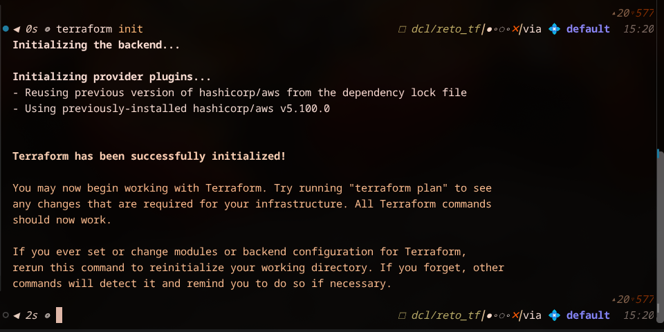
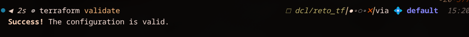
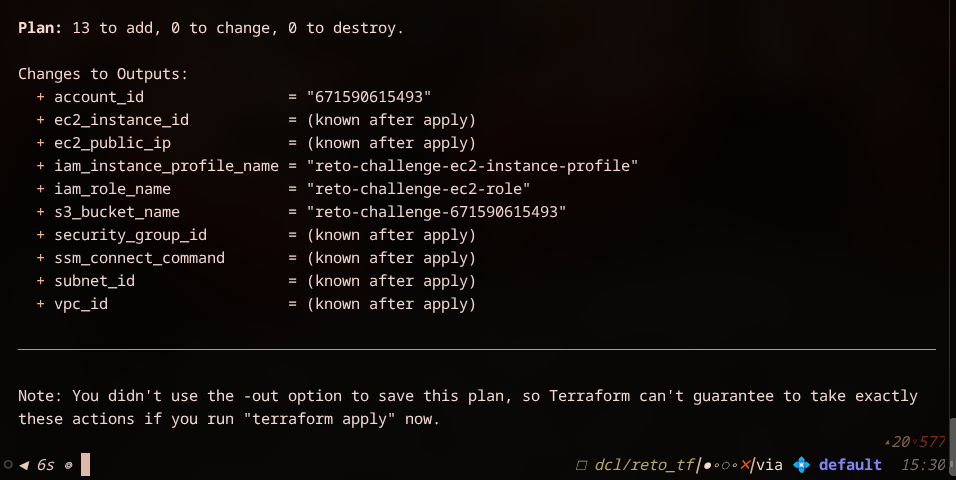
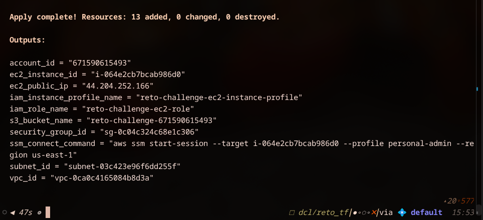
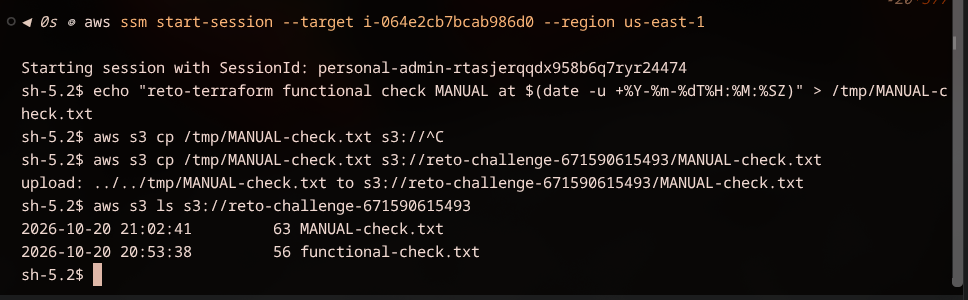

# Reto Terraform — Digital Café Luna (S15)

Slice mínimo e independiente: **EC2 + Security Group + IAM Role/Instance Profile + S3**,
con su propia VPC/subnet pública para aislarlo por completo de la solución base en
`dcl/terraform`. Usa su propio state (carpeta separada), por lo que `terraform destroy`
aquí no toca ningún recurso de `dcl/terraform`.

## Alcance

- VPC (`10.99.0.0/16`) + subnet pública + IGW + route table — contexto de red propio del reto.
- EC2 (`t3.micro`, Amazon Linux 2023) — recurso computacional.
- S3 bucket privado — recurso dependiente del workload.
- Security Group sin ingreso (solo egreso) — el EC2 se administra vía **SSM Session
  Manager**, no SSH, por lo que no se necesita abrir ningún puerto ni CIDR.
- IAM Role + Instance Profile — permisos mínimos: `AmazonSSMManagedInstanceCore` (SSM) y
  una policy inline que solo permite `GetObject`/`PutObject`/`ListBucket` sobre el bucket
  del reto.

Todos los recursos se nombran con el prefijo `reto-` (variable `reto_prefix`).

## Prerrequisitos

- Terraform >= 1.5
- AWS CLI configurado con un perfil (`aws configure --profile <perfil>`) con permisos
  para VPC, EC2, IAM y S3.
- (Opcional, para el functional check) [Session Manager plugin para AWS CLI](https://docs.aws.amazon.com/systems-manager/latest/userguide/session-manager-working-with-install-plugin.html).

## Variables

Copiar el archivo de ejemplo y ajustar el perfil de AWS:

```bash
cp terraform.tfvars.example terraform.tfvars
```

| Variable              | Descripción                                   | Default              |
|------------------------|------------------------------------------------|-----------------------|
| `reto_project`         | Nombre del proyecto                             | `digital-cafe-luna`   |
| `reto_prefix`          | Prefijo de aislamiento del reto                 | `reto`                |
| `reto_environment`     | Nombre del ambiente                             | `challenge`           |
| `reto_owner_team`      | Equipo propietario                              | `team-04`             |
| `reto_managed_by`      | Medio de gestión                                | `terraform`            |
| `reto_aws_profile`     | Perfil de AWS CLI a usar                        | `default`             |
| `reto_region`          | Región AWS                                      | `us-east-1`           |
| `reto_instance_type`   | Tipo de instancia EC2                           | `t3.micro`             |

`terraform.tfvars` no se versiona (ver `.gitignore`).

## Uso

```bash
terraform init
terraform validate
terraform plan
terraform apply
```

## Functional check

El `user_data` del EC2 escribe automáticamente un archivo (`functional-check.txt`) al
bucket S3 usando el rol IAM del reto, al arrancar la instancia. Para validar el slice:

```bash
# Esperar ~1-2 min tras el apply a que la instancia arranque y corra el user_data
aws s3 ls s3://$(terraform output -raw s3_bucket_name)/ --profile <perfil>
aws s3 cp s3://$(terraform output -raw s3_bucket_name)/functional-check.txt - --profile <perfil>
```

Si el objeto existe y tiene contenido, el EC2 pudo asumir el IAM Role, escribir al bucket
S3 y la red (VPC/subnet/IGW/SG) permitió la salida a internet necesaria.

Alternativamente, para una verificación interactiva vía SSM (sin SSH):

```bash
$(terraform output -raw ssm_connect_command)
```

## Cleanup

```bash
terraform destroy
```

Esto elimina únicamente los recursos de este state (`dcl/reto_tf`), todos prefijados con
`reto-`. No afecta la VPC, subnets ni demás recursos de `dcl/terraform`.


## Evidencias

### Terraform init -> PASS


### Terraform validate -> PASS


### Terraform plan -> PASS


### Terraform apply -> PASS


### Functional check -> PASS


### Terraform destroy -> PASS
